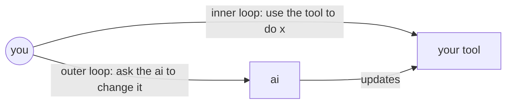

---
tags:
  - Software
  - AI
layout: post
---
ai makes building software so cheap that users could just build the tools they want themselves

how does software get shaped today?
1. devs build features, users just use them
	- if the feature you want doesnt exist, tough luck
2. some software lets users build a bit themselves, like excel
	- a cell can hold a formula like =A1+A2, so non programmers end up programming without realising
	- but this caps out, turning a rough idea into real code is hard, so most people stop at simple formulas

what does ai change?
- ai turns a rough idea into real code for you
- so users can build whole tools on the fly, e.g "make me a tool that shows which customers havent paid this month"
- this gives you two loops
	1. inner loop: use the tool to do x, e.g check who hasnt paid
	2. outer loop: ask the ai to change the tool, e.g "also show how late they are"
	- excel already works like this, typing in numbers is the inner loop, editing formulas is the outer loop

so whats next?
- security: ai written tools run on shared data and nobody reviews them, so what stops a tool from leaking that data? does every tool need permissions like phone apps?
- tools vs data: if you share a tool, do you only share the code and have it run on each users own data, so nothing leaks?
- if tools are this cheap, why share at all? maybe the only reason is trust, a shared tool is already tested and debugged
- sharing does have a nice upside, users make tools better for other users, but does that survive when making your own is ~free?
- forks: i copy your tool and tweak it, someone tweaks mine, now 50 versions give slightly different numbers, which ones right?
- breaking: someone renames a column and 200 tools nobody owns break, does the ai fix them, and how do you know the fix is right?
- wrong answers: beginners cant catch ai mistakes, so a subtly wrong shared tool spreads the mistake to everyone
- liability: a coworkers shared tool makes a payment mistake, whos to blame?
- money: if users build the features, the vendor sells the data layer and the sharing layer, is that just notion and airtable again?
- agents: if agents do the work, tools dont need a ui at all, just safe functions over data

sources
- [geoffreylitt.com/2023/03/25/llm-end-user-programming](https://www.geoffreylitt.com/2023/03/25/llm-end-user-programming.html)
- [inkandswitch.com/essay/malleable-software](https://www.inkandswitch.com/essay/malleable-software/)
