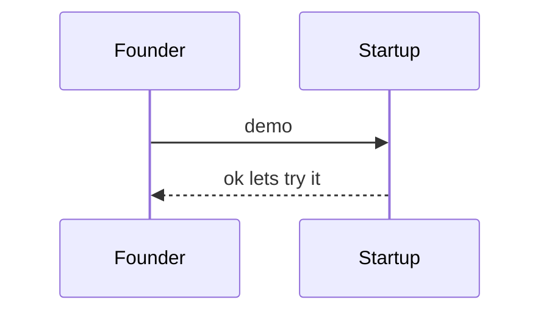

---
tags:
  - Tech
layout: post
---
testing mermaid and latex rendering

inline math: $e^{i\pi} + 1 = 0$ and $a_1 + b_2 = c$

block math:

$$
\int_0^\infty e^{-x^2}\,dx = \frac{\sqrt{\pi}}{2}
$$

flowchart:

sequence:

